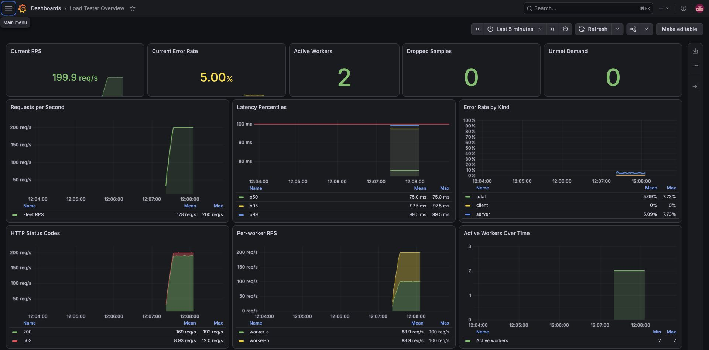
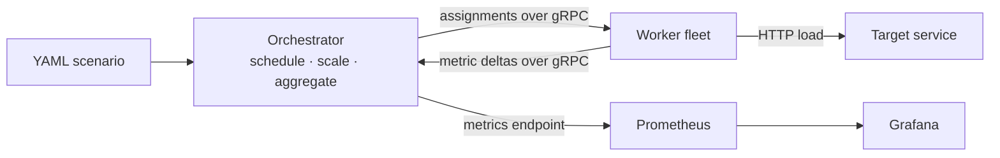

# Distributed Load Testing Platform

A distributed load generator that coordinates Go workers over gRPC to produce
and measure HTTP traffic.

**Stack:** Go · gRPC · Docker · Kubernetes · Prometheus · Grafana



*Grafana dashboard from the local Docker Compose demo.*

## Capabilities

- Open and closed load models; the open constant-rate model uses coordinated-omission-aware scheduling.
- Distributed worker orchestration with additive histogram aggregation.
- Docker and Kubernetes fleet management with worker failure recovery.
- Prometheus metrics and provisioned Grafana dashboards.

## Architecture



The orchestrator schedules demand and manages fleet size. Workers execute
requests and stream metric deltas back for aggregation; Prometheus scrapes the
resulting metrics for Grafana.

## Quickstart

Requires Git and Docker with Docker Compose.

```bash
git clone https://github.com/marcuslin123/load-tester.git
cd load-tester
docker compose up --build --detach
```

Open [Grafana](http://localhost:3000) and sign in with `admin` / `admin`. The
committed demo runs for five minutes at 200 RPS with two workers against the
included target service.

Optionally follow the final result:

```bash
docker compose logs --follow orchestrator
```

Remove the local stack and its Prometheus data:

```bash
docker compose down --volumes
```

## How It Works

1. Parse and validate the YAML scenario.
2. Schedule open- or closed-model demand across workers.
3. Execute requests while streaming counters and histograms over gRPC.
4. Merge metric deltas for the final result and live Prometheus export.

## Verification

```bash
go test ./...
./scripts/test-compose.sh
```

The Compose smoke test verifies service health, worker contributions, live
Prometheus series, provisioned Grafana queries, and cleanup.

## Cloud Benchmark

On November 13, 2026 (Pacific time), the platform ran a live HTTP benchmark on
AWS EKS in `us-west-2`. The three-minute attempt configured at 212 RPS averaged
**194.32 requests per second**, including ramp-up, and completed **34,978
successful requests** with **2 ms p95 latency**, zero request failures, zero
dropped samples, and one unmet arrival.

One worker handled the traffic. The run recorded no worker scale-up, and the
target HPA experiment did not start. A separate AWS inventory check verified
teardown. See the [run results and methodology](docs/eks-benchmark.md#latest-aws-run).

## Documentation

- [Design document](docs/design.md): architecture, invariants, and trade-offs.
- [Roadmap](docs/roadmap.md): incremental milestones and validation gates.

The current target adapter is HTTP, and the orchestrator is intentionally a
single process. A gRPC target adapter is the next project layer.
