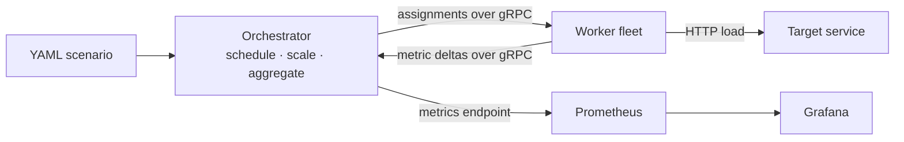

# Piece 24A README Implementation Plan

> **For agentic workers:** REQUIRED SUB-SKILL: Use superpowers:subagent-driven-development (recommended) or superpowers:executing-plans to implement this plan task-by-task. Steps use checkbox (`- [ ]`) syntax for tracking.

**Goal:** Create a concise, recruiter-friendly README with a real local Grafana
screenshot, an editable architecture diagram, a reproducible Compose quickstart,
and an honest boundary around the pending EKS benchmark.

**Architecture:** The README is the short entry point; `docs/design.md` and
`docs/roadmap.md` retain the detailed reasoning and project history. A root Go
contract test protects executable commands, local links, and the real screenshot
without freezing incidental prose. The committed Compose stack supplies the
dashboard evidence; no platform behavior changes are part of this work.

**Tech Stack:** GitHub-flavored Markdown, Mermaid, Go 1.26.5 standard-library
tests, Docker Compose, Grafana 13.1.0, Prometheus 3.13.1

**Spec:** `docs/superpowers/specs/2026-08-25-readme-phase-a-design.md`

## Global Constraints

- Keep every README section short enough to scan in roughly two minutes.
- Use only measured local behavior; do not claim AWS deployment, EKS throughput,
  or a performance ceiling before Piece 23.
- Use GitHub-native Mermaid for the approved layered-system diagram.
- Use direct Docker Compose commands; do not add a Makefile or README-only wrapper.
- Store the real local dashboard screenshot at
  `docs/images/load-tester-overview.png`.
- Link `docs/design.md` and `docs/roadmap.md` from the README.
- Do not change scheduler, fleet, metrics, Compose, or dashboard behavior.
- Keep Piece 24 open until Piece 24B replaces the pending EKS status with measured
  results.
- Do not stage, commit, or push until Marcus reviews the complete implementation
  and explicitly approves those Git operations.

## File Structure

- Create `docs/images/load-tester-overview.png`: real local Grafana dashboard
  evidence captured from the committed Compose stack.
- Create `README.md`: concise project overview, screenshot, architecture,
  quickstart, validation, benchmark status, and documentation links.
- Create `readme_test.go`: objective README contract checks using only the Go
  standard library.
- Modify `docs/roadmap.md`: record the approved Piece 24A/24B delivery split
  without marking the Phase 4 gate complete.

---

### Task 1: Capture The Real Dashboard

**Files:**
- Create: `docs/images/load-tester-overview.png`
- Inspect: `compose.yaml`
- Inspect: `deploy/compose/demo.yaml`
- Inspect: `deploy/compose/grafana/dashboards/load-tester-overview.json`

**Interfaces:**
- Consumes: the root `compose.yaml`, which provisions the dashboard with UID
  `load-tester-overview` and runs the five-minute, 200-RPS, two-worker demo.
- Produces: a valid PNG at `docs/images/load-tester-overview.png`, at least
  1200x650 pixels, consumed by `README.md` and `readme_test.go`.

- [ ] **Step 1: Confirm a clean Compose starting state**

Run:

```bash
docker compose down --volumes --remove-orphans
docker compose ps --all
```

Expected: cleanup exits zero and no project containers remain.

- [ ] **Step 2: Start the exact documented demo**

Run:

```bash
docker compose up --build --detach
docker compose ps
```

Expected: `target`, `orchestrator`, `worker-a`, `worker-b`, `prometheus`, and
`grafana` exist; health-checked services become healthy.

- [ ] **Step 3: Wait for useful dashboard data**

Poll the existing endpoints rather than sleeping a guessed duration:

```bash
curl --fail http://localhost:3000/api/health
curl --fail --get --data-urlencode 'query=rate(loadtester_requests_total[10s])' http://localhost:9090/api/v1/query
curl --fail --user admin:admin http://localhost:3000/api/dashboards/uid/load-tester-overview
```

Expected: Grafana reports a healthy database, Prometheus returns a positive
finite request rate, and Grafana returns the provisioned `Load Tester Overview`
dashboard.

- [ ] **Step 4: Capture the dashboard without unrelated desktop content**

Open:

```text
http://localhost:3000/d/load-tester-overview/load-tester-overview?orgId=1&from=now-5m&to=now&refresh=1s
```

Sign in with `admin` / `admin`. Use a desktop viewport of at least 1440x900,
collapse unrelated browser chrome where the browser tool permits, and capture the
dashboard itself to:

```text
docs/images/load-tester-overview.png
```

The image must visibly include the dashboard title plus request rate, latency,
error, active-worker/per-worker, and unmet-demand information. It must not expose
cookies, tokens, local file paths, unrelated tabs, or other desktop content.

- [ ] **Step 5: Inspect the actual PNG**

Use `view_image` on the saved path. Reject and recapture if text is clipped,
panels are blank, a login form is visible, or the dashboard title and important
panels cannot be identified.

Also verify the file type and dimensions:

```bash
file docs/images/load-tester-overview.png
sips -g pixelWidth -g pixelHeight docs/images/load-tester-overview.png
```

Expected: PNG image, width at least 1200, height at least 650.

- [ ] **Step 6: Stop the manual demo cleanly**

Run:

```bash
docker compose down --volumes --remove-orphans
docker compose ps --all
```

Expected: volumes and containers are removed; no project services remain.

- [ ] **Step 7: Review checkpoint**

Show Marcus `docs/images/load-tester-overview.png` and report the measured local
scenario shown in it. Do not stage or commit.

---

### Task 2: Add The README And Objective Contract Tests

**Files:**
- Create: `readme_test.go`
- Create: `README.md`
- Consume: `docs/images/load-tester-overview.png`
- Link: `docs/design.md`
- Link: `docs/roadmap.md`

**Interfaces:**
- Consumes: the PNG contract from Task 1 and the existing Compose commands.
- Produces: `README.md` plus `TestReadmeContract`, which later tasks and CI run
  through `go test ./...`.

- [ ] **Step 1: Write the failing README contract test**

Create `readme_test.go`:

```go
package loadtester_test

import (
	"bytes"
	"image/png"
	"os"
	"path/filepath"
	"regexp"
	"strings"
	"testing"
)

var markdownTarget = regexp.MustCompile(`!?\[[^]]*\]\(([^)]+)\)`)

func TestReadmeContract(t *testing.T) {
	contents, err := os.ReadFile("README.md")
	if err != nil {
		t.Fatal(err)
	}

	for _, required := range []string{
		"docker compose up --build --detach",
		"docker compose logs --follow orchestrator",
		"docker compose down --volumes",
		"http://localhost:3000",
		"docs/images/load-tester-overview.png",
		"docs/design.md",
		"docs/roadmap.md",
		"```mermaid",
	} {
		if !bytes.Contains(contents, []byte(required)) {
			t.Errorf("README.md does not contain %q", required)
		}
	}

	for _, match := range markdownTarget.FindAllSubmatch(contents, -1) {
		target := strings.TrimSpace(string(match[1]))
		if fields := strings.Fields(target); len(fields) > 0 {
			target = strings.Trim(fields[0], "<>")
		}
		if target == "" || strings.HasPrefix(target, "#") ||
			strings.Contains(target, "://") {
			continue
		}
		target = strings.SplitN(target, "#", 2)[0]
		if _, err := os.Stat(filepath.FromSlash(target)); err != nil {
			t.Errorf("README local target %q: %v", target, err)
		}
	}

	image, err := os.Open("docs/images/load-tester-overview.png")
	if err != nil {
		t.Fatal(err)
	}
	defer image.Close()
	config, err := png.DecodeConfig(image)
	if err != nil {
		t.Fatalf("decode dashboard PNG: %v", err)
	}
	if config.Width < 1200 || config.Height < 650 {
		t.Fatalf("dashboard PNG is %dx%d, want at least 1200x650", config.Width, config.Height)
	}
}
```

- [ ] **Step 2: Run the test to verify RED**

Run:

```bash
GOCACHE=/tmp/load-tester-go-cache go test . -run TestReadmeContract -count=1
```

Expected: FAIL because `README.md` does not exist.

- [ ] **Step 3: Create the concise README**

Create `README.md` with this content and no additional long-form sections:

````markdown
# Distributed Load Testing Platform

A distributed load generator that coordinates Go workers over gRPC to produce
and measure HTTP traffic.

**Stack:** Go · gRPC · Docker · Kubernetes · Prometheus · Grafana


## Capabilities

- Open and closed load models with coordinated-omission-aware scheduling.
- Distributed worker orchestration with additive histogram aggregation.
- Docker and Kubernetes fleet management with worker failure recovery.
- Prometheus metrics and provisioned Grafana dashboards.

## Architecture



The orchestrator schedules demand and manages fleet size. Workers execute
requests and stream metric deltas back for aggregation; Prometheus scrapes the
resulting metrics for Grafana.

## Quickstart

Requires Git and Docker with Docker Compose.

```bash
git clone https://github.com/marcuslin123/load-tester.git
cd load-tester
docker compose up --build --detach
```

Open [Grafana](http://localhost:3000) and sign in with `admin` / `admin`. The
committed demo runs for five minutes at 200 RPS with two workers against the
included target service.

Optionally follow the final result:

```bash
docker compose logs --follow orchestrator
```

Remove the local stack and its Prometheus data:

```bash
docker compose down --volumes
```

## How It Works

1. Parse and validate the YAML scenario.
2. Schedule open- or closed-model demand across workers.
3. Execute requests while streaming counters and histograms over gRPC.
4. Merge metric deltas for the final result and live Prometheus export.

## Verification

```bash
go test ./...
./scripts/test-compose.sh
```

The Compose smoke test verifies service health, worker contributions, live
Prometheus series, provisioned Grafana queries, and cleanup.

## Cloud Benchmark

Local Docker Compose and kind validation are complete. The reproducible EKS
benchmark and measured cloud results are tracked in Piece 23.

## Documentation

- [Design document](docs/design.md): architecture, invariants, and trade-offs.
- [Roadmap](docs/roadmap.md): incremental milestones and validation gates.

The current target adapter is HTTP, and the orchestrator is intentionally a
single process. A gRPC target adapter is the next project layer.
````

- [ ] **Step 4: Format and run the focused test to verify GREEN**

Run:

```bash
gofmt -w readme_test.go
GOCACHE=/tmp/load-tester-go-cache go test . -run TestReadmeContract -count=1
```

Expected: PASS.

- [ ] **Step 5: Review README accuracy against source configuration**

Verify each README claim against:

```bash
rg -n 'rate:|duration:|min_workers:|max_workers:' deploy/compose/demo.yaml
rg -n 'worker-a|worker-b|grafana|prometheus' compose.yaml
rg -n 'constant-vus|constant-rate|coordinated omission' docs/design.md
```

Expected: 200 RPS, five minutes, exactly two fixed workers, both load models in
the design, and no AWS performance claim.

- [ ] **Step 6: Review checkpoint**

Give Marcus exact links to `README.md`, `readme_test.go`, and the dashboard PNG.
Do not stage or commit.

---

### Task 3: Record The Two-Pass Gate And Verify The Front Door

**Files:**
- Modify: `docs/roadmap.md:716-734`
- Verify: `README.md`
- Verify: `readme_test.go`
- Verify: `docs/images/load-tester-overview.png`

**Interfaces:**
- Consumes: the complete Piece 24A README contract from Task 2.
- Produces: an explicit roadmap boundary and end-to-end evidence that the README
  works from a clean local state.

- [ ] **Step 1: Add the Piece 24A/24B roadmap split**

After the existing `Done when` paragraph in Piece 24, add:

```markdown
Deliver Piece 24 in two passes. Piece 24A creates the concise README, local
dashboard screenshot, architecture diagram, and verified Compose quickstart
without estimated cloud results. Piece 24B follows Piece 23, replaces the pending
benchmark note with measured EKS topology and results, and closes the Phase 4
gate. Piece 24 remains incomplete until Piece 24B contains no placeholders or
pending benchmark language.
```

Do not mark the Piece 24 heading complete.

- [ ] **Step 2: Run static documentation and source checks**

Run:

```bash
GOCACHE=/tmp/load-tester-go-cache go test . -run TestReadmeContract -count=1
GOCACHE=/tmp/load-tester-go-cache go test ./...
docker compose config --quiet
git diff --check
```

Expected: every command exits zero.

- [ ] **Step 3: Execute the README quickstart exactly as written**

Start from no project containers:

```bash
docker compose down --volumes --remove-orphans
docker compose up --build --detach
```

Then verify the public README endpoints and result stream:

```bash
curl --fail http://localhost:3000/api/health
curl --fail http://localhost:9090/-/ready
docker compose logs --no-color orchestrator
```

Expected: Grafana and Prometheus are ready, the orchestrator is running or has
completed normally, and its log contains registration and load-test activity.

Clean up using the README command:

```bash
docker compose down --volumes
docker compose ps --all
```

Expected: cleanup exits zero and no project services remain.

- [ ] **Step 4: Run the stronger existing Compose acceptance test**

Run:

```bash
./scripts/test-compose.sh
```

Expected output includes:

```text
Compose containers: PASS
Prometheus target: PASS
Grafana dashboard: PASS
Grafana dashboard queries: PASS
Cleanup: PASS
```

- [ ] **Step 5: Render and inspect the README**

Render the Markdown with a GitHub-compatible preview. Inspect both a desktop and
narrow layout. Verify:

- the dashboard image loads and remains readable;
- Mermaid renders without a syntax error;
- headings and code blocks do not overflow;
- the quickstart appears before detailed verification;
- local links resolve to `docs/design.md` and `docs/roadmap.md`;
- the only EKS language is the pending Piece 23 status, not a measurement claim.

- [ ] **Step 6: Final review gates**

Request:

1. A Terra review focused on README accuracy, command reproducibility, image
   quality, and contract-test usefulness.
2. A Sol review of the complete base-to-working-tree change focused on misleading
   infrastructure/performance claims and whether the README accurately represents
   the distributed-system boundaries.

Resolve material findings and rerun affected focused tests plus `go test ./...`,
`docker compose config --quiet`, and `git diff --check`.

- [ ] **Step 7: User review and Git approval gate**

Provide exact file/line references for:

- README opening, architecture, quickstart, verification, cloud status, and docs;
- the dashboard screenshot;
- contract tests;
- the roadmap delivery split.

Report the live Compose evidence and any residual uncertainty. Stop without
staging, committing, or pushing. Only after Marcus explicitly approves, create a
commit authored as `Marcus Lin <mlin23530@gmail.com>` and push the current branch.
